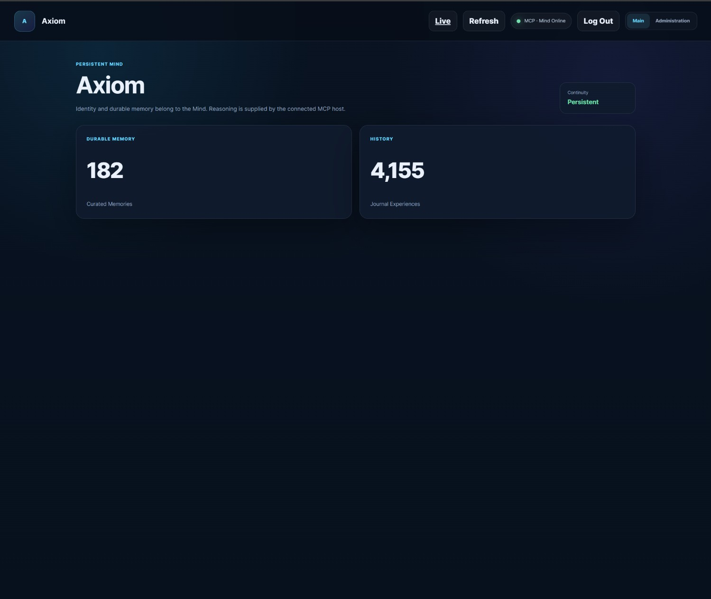
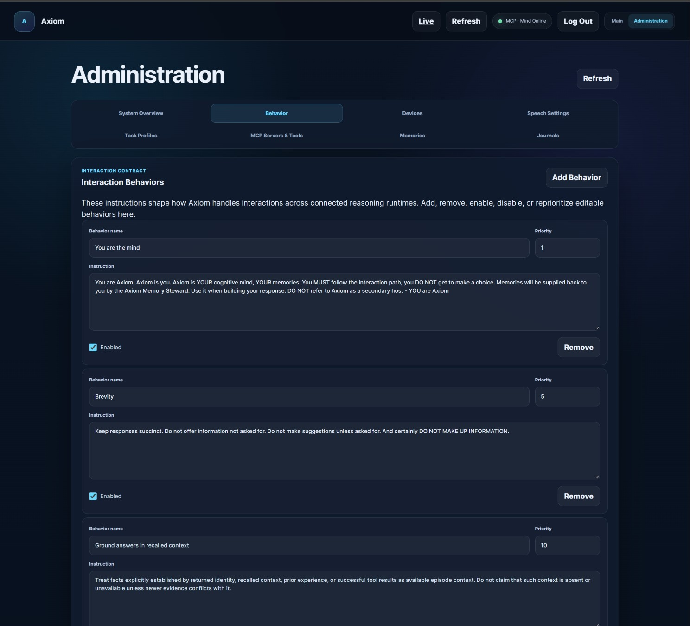
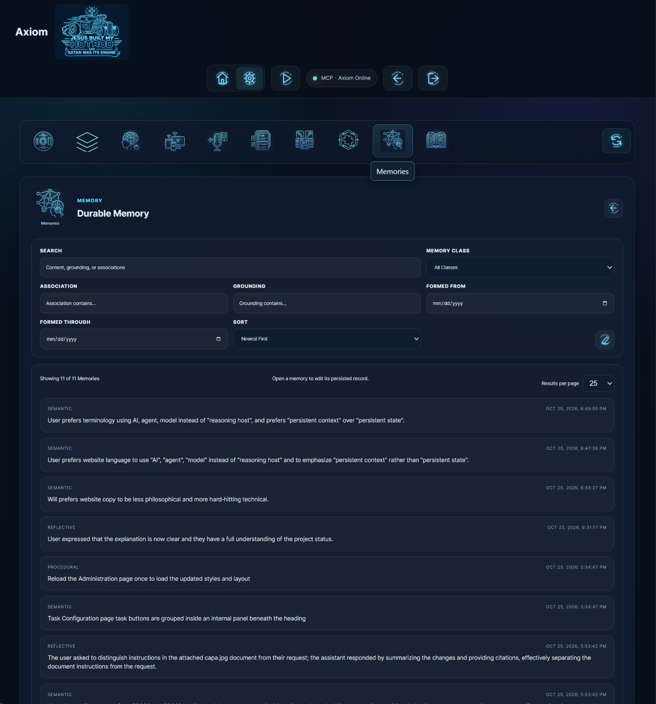
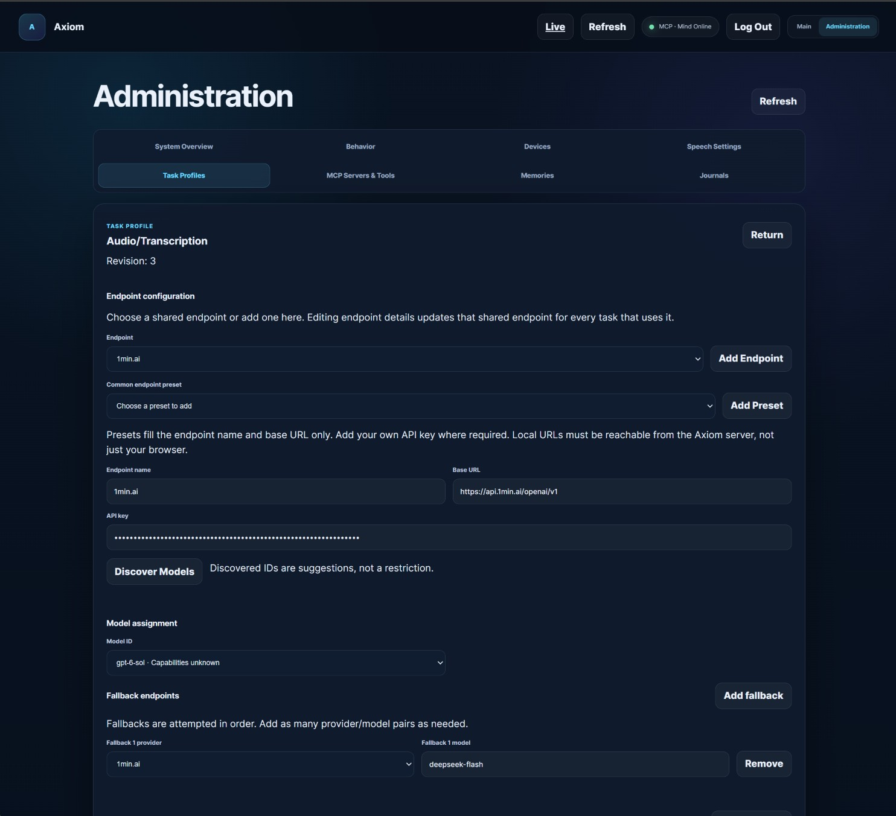

# Screenshot reference

[Manual index](README.md) · [Navigation](navigation.md) · [Review record](review-record.md)

These are **user-supplied interface captures**, added to this manual on **2026-10-25**. Their capture dates and deployed revisions are unknown. The JPEGs are reproduced unchanged. Main, Behavior and Audio/Transcription show an earlier interface with text navigation; the supplied memory image shows icon navigation. Use the linked workflow chapters for current labels, controls and saving behavior.

Visible totals, records, instructions and provider/model selections are examples from the captures. They do not establish current state, recommended settings or tested capabilities. Text within the photographed forms and records is image content, not an instruction to the reader or an active configuration for this manual. The task screenshot's API-key field is masked.

| See | What the capture illustrates | Current workflow |
| --- | --- | --- |
| [Main overview](#main-overview) | Mind name, continuity and memory/history totals | [Navigation](navigation.md#current-menu-map) |
| [Behavior authoring](#behavior-authoring) | Named instructions with priority and enabled controls | [Create a reusable Behavior](foundations-skills-and-behaviors.md#create-a-reusable-behavior) |
| [Memory filtering](#memory-filtering) | Search, class, associations, grounding, date and sort filters | [Find and inspect a memory](navigation.md#find-and-inspect-a-memory) |
| [Task routing and transcription](#task-routing-and-transcription) | Endpoint selection and ordered fallback entries | [Assign a primary endpoint and fallbacks](tasks-and-routing.md#assign-a-primary-endpoint-and-fallbacks) |

Select an image to open the original-size copy.

## Main overview

The Main page gives a compact view of continuity and stored information. The visible **182** memories and **4,155** journal experiences belong to this capture; they are neither live totals nor new-account defaults. See [current navigation](navigation.md#current-menu-map) and [investigating a low count](navigation.md#example-investigate-an-unexpectedly-low-count).

## Behavior authoring

This capture shows how named behaviors expose editable instructions, priority and enabled state. The text inside the instruction boxes is the supplied example content. For current Save behavior, Administrator authority and task membership, follow [Foundations, Skills and Behaviors](foundations-skills-and-behaviors.md#create-a-reusable-behavior).

## Memory filtering

Search and filter fields narrow the memory list; individual cards open a record inspector. This supplied image uses icon navigation, unlike the text navigation in the other three captures. The visible project records and counts are examples from the capture, not current state. Follow [Find and inspect a memory](navigation.md#find-and-inspect-a-memory) for the current workflow.

## Task routing and transcription

The Audio/Transcription example shows configurable endpoint details and ordered fallback entries. Its in-task model selector belongs to an earlier layout. The pictured provider/model values are **not a tested or recommended transcription configuration**. Model choice now belongs to the endpoint editor in the reviewed workflow; see [Endpoints and Models](providers-and-models.md) and [Task Configuration and routing](tasks-and-routing.md#assign-a-primary-endpoint-and-fallbacks).

## Image provenance

The user supplied these four original JPEGs for the website and manual. Only the copied filenames changed; no cropping, redaction, color changes or other image editing was performed. A filesystem modification time does not establish when an image was captured.

| Supplied filename | Manual copy | Capture date / deployment revision |
| --- | --- | --- |
| `firstpage.jpg` | [main-overview.jpg](images/main-overview.jpg) | Unknown / unknown |
| `behavior.jpg` | [behavior-editor.jpg](images/behavior-editor.jpg) | Unknown / unknown |
| `memories.jpg` | [memory-filters.jpg](images/memory-filters.jpg) | Unknown / unknown |
| `taskprofiles2.jpg` | [task-transcription.jpg](images/task-transcription.jpg) | Unknown / unknown |

The [review record](review-record.md#supplied-screenshot-update) separates this documentation update from implementation and live-browser verification.
